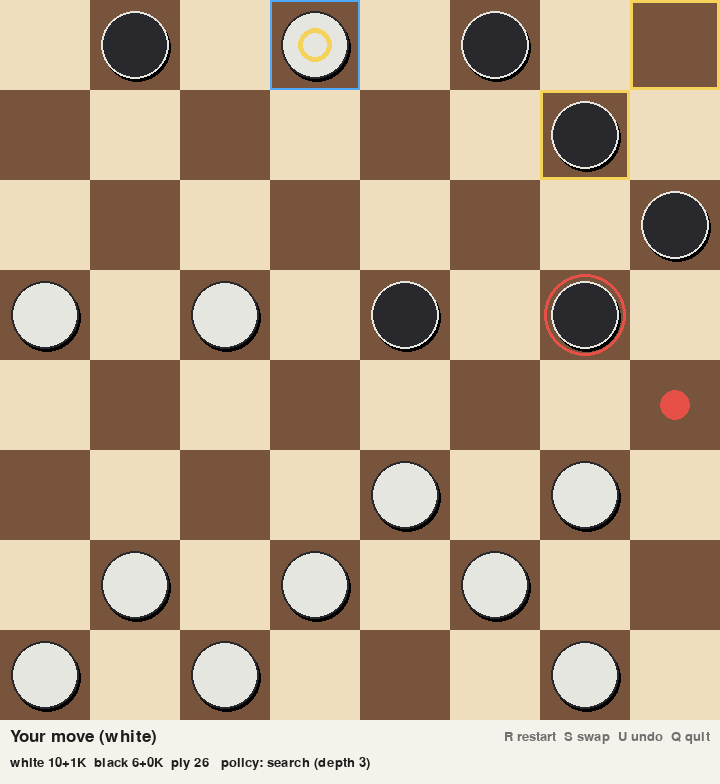
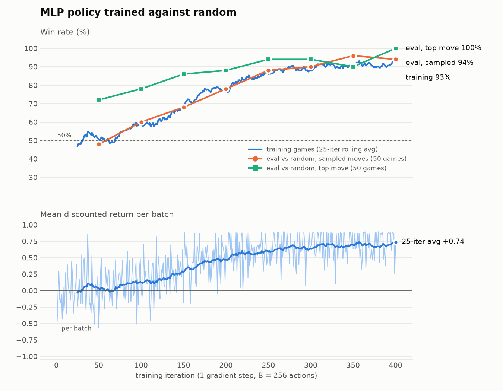
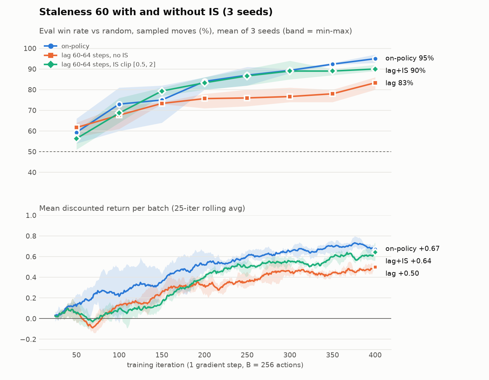
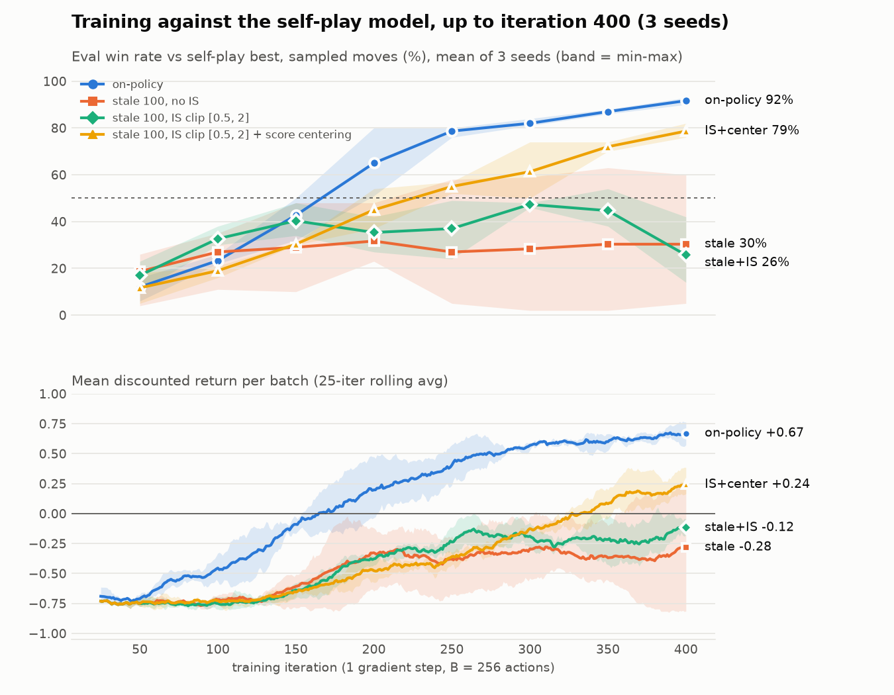

# Checkers RL

N×N checkers as a [Gymnasium](https://gymnasium.farama.org/) environment, plus everything built on it: policy and value networks, a REINFORCE training loop, a policy+value tree search, a pygame UI to play against any policy, and experiments on learning from stale data with importance-sampling corrections.

```bash
uv venv .venv && uv pip install -p .venv -r requirements.txt
source .venv/bin/activate
python -m pytest -q tests
python -m checkers.ui --policy checkers.search:load_search_policy   # play against the strongest agent
```

All commands below assume the virtualenv is active and are run from the repo root.

## Contents

| path | what it is |
|---|---|
| [checkers/game.py](checkers/game.py) | the rules |
| [checkers/encoding.py](checkers/encoding.py) | observations, action ids, legal-move masks |
| [checkers/env.py](checkers/env.py) | `CheckersEnv` (Gymnasium, `Checkers-v0`) and `RewardConfig` |
| [checkers/policies.py](checkers/policies.py) | `Policy` interface, `RandomPolicy`, `GreedyPolicy`, `load_policy` |
| [checkers/mlp.py](checkers/mlp.py) | one-hidden-layer policy network and `MLPPolicy` |
| [checkers/value.py](checkers/value.py) | one-hidden-layer value network V(s) |
| [checkers/search.py](checkers/search.py) | depth-limited search guided by the policy and value nets |
| [checkers/ui.py](checkers/ui.py) | pygame UI |
| [train.py](train.py) | REINFORCE training, self-play, stale rollouts, clipped IS, score centering |
| [train_value.py](train_value.py) | fits the value network for a frozen policy |
| [compare_search.py](compare_search.py) | plain policy vs search agents, head to head |
| [plot_training.py](plot_training.py), [plot_compare.py](plot_compare.py) | training curves for one run / several settings averaged over seeds |
| `checkpoints/` | trained models, training logs and plots |

## Rules

- Board is `size × size` (any size ≥ 4, default 8). Pieces sit on dark squares, `(size-2)//2` rows each.
- **Men** move 1 square diagonally **forward**, and capture by jumping 2 squares over an adjacent opponent piece, **forward or backward**.
- **One capture per move**: no multi-jump chains.
- Reaching the far row promotes to **king**. Kings move **any number of squares in any diagonal direction**, and capture a single piece at any distance along the diagonal, landing on the square right behind it (`flying_kings=False` for 1-square kings).
- Captures are mandatory by default (`forced_capture=False` to disable).
- No legal move = loss. Draw after `no_progress_limit` (default 80) plies with no capture or man move, or after `max_plies`.

## Environment

```python
import checkers  # registers "Checkers-v0"
from checkers import CheckersEnv, RandomPolicy, RewardConfig

env = CheckersEnv(
    size=8,
    opponent=RandomPolicy(),          # any Policy or callable(obs, mask, info) -> action
    agent_player=1,                   # 1 (white, moves first), -1, or "random"
    obs_mode="board",                 # or "planes"
    rewards=RewardConfig(capture=0.05, captured=-0.05),
    illegal_action="raise",           # or "penalize" (reward=illegal, episode ends)
)
obs, info = env.reset(seed=0)
action = info["valid_actions"][0]
obs, reward, terminated, truncated, info = env.step(action)
```

| | |
|---|---|
| **State** | `board`: int8 `(N, N)` in {-2..2}, own pieces positive. `planes`: float32 `(5, N, N)` = own men, own kings, opponent men, opponent kings, "my turn". Always from the agent's perspective (rotated 180° when playing -1), so one policy can play both sides. |
| **Action** | "from → to": `action = from_idx * N² + to_idx`, `idx = row * N + col` (in the agent's frame). `Discrete(N⁴)`. Helpers: `encode_action`, `decode_action`, `env.action_from_squares(frm, to)` (absolute squares). |
| **Valid actions** | `info["action_mask"]` (bool, `N⁴`), `info["valid_actions"]`, `env.action_masks()` (works with sb3-contrib `MaskablePPO`), `env.valid_actions()`. |
| **Rewards** | `RewardConfig`: win +1, loss -1, draw 0, plus optional shaping for captures, pieces lost, promotions, per-step and illegal moves. Events during the opponent's reply are included in the same step. |
| **Info** | `board` (absolute frame), `last_move`, `winner` (1/-1/0/None), `plies`, `agent_player`. |

Each `step` = agent move + opponent reply, so every observation is the agent's turn.

## Policies

```python
class Policy:
    def act(self, obs, action_mask, info) -> int: ...
    def reset(self, seed=None): ...
```

`info` holds `player`, `legal_actions`, `legal_moves` (canonical `(from, to)`) and `game` (an absolute-frame `CheckersGame` copy, for search-based policies). Built in: `RandomPolicy` and `GreedyPolicy` (prefers capturing kings, then men, then promoting). Plain functions work too (`FunctionPolicy` / `as_policy`). `checkers.policy_inputs(game, obs_mode)` builds `(obs, mask, info)` for whoever is to move.

`load_policy(spec, **kwargs)` takes `random`, `greedy`, `package.module:Name` or `file.py:Name`; a class or no-argument factory is called with the kwargs.

## UI



Click a piece to see its moves (green outlines mark pieces that can move; red dot + ring mark a capture), then click a destination. **R** restart, **S** swap sides, **U** undo, **Q** quit.

```bash
python -m checkers.ui --policy random                              # you play white
python -m checkers.ui --policy greedy --human-player -1            # you play black
python -m checkers.ui --policy checkers.search:load_search_policy  # the search agent
python -m checkers.ui --policy checkers.mlp:MLPPolicy --obs-mode board \
    --policy-kwargs '{"checkpoint": "checkpoints/mlp_selfplay2_best.pt", "deterministic": true}'
python -m checkers.ui --watch --policy greedy --policy2 random     # policy vs policy
```

Other options: `--size`, `--no-forced-capture`, `--no-flying-kings`, `--delay` (ms before a policy moves). The MLP policies expect `--obs-mode board`.

## Models

**Policy network** ([checkers/mlp.py](checkers/mlp.py)): `board → Linear(64, 256) → ReLU → Linear(256, N⁴)`, one logit per (from, to) pair. Invalid actions get `-inf` logits, so the softmax only covers legal moves. `MLPPolicy` wraps it as a `Policy` that samples moves, or plays the top move with `deterministic=True`.

```python
from checkers.mlp import MLPPolicyNet, MLPPolicy, load_mlp, save_mlp

net = MLPPolicyNet(size=8, hidden=256)
dist = net.distribution(obs, info["action_mask"])   # Categorical over legal moves
opponent = MLPPolicy(checkpoint="checkpoints/mlp_selfplay2_best.pt")
```

**Value network** ([checkers/value.py](checkers/value.py)): same shape with a single output, V(s) = expected discounted return from `s` for the player to move.

**Search** ([checkers/search.py](checkers/search.py)): at each node the policy proposes its top `width` moves; the tree goes `depth` plies deep (alternating sides), so depth 3 and width 2 give 8 leaves. Leaves are scored with the value net, finished games with their real result. The searching side takes the max, the opponent the min (or mean). It is a deterministic, policy-pruned minimax, not sampled MCTS.

## Training (`train.py`)

REINFORCE: each iteration plays full games until there are at least B agent actions, keeps exactly B (nothing carries over to the next batch), and takes one Adam step on

```
loss = -mean( G_t * log pi(a_t | s_t) )        G_t = discounted reward-to-go (gamma = 0.99)
```

Rewards are +1 / -1 / 0 at the end of the game only. The batch also records the behaviour log-probabilities, so off-policy variants can reweight.

| option | effect |
|---|---|
| `--opponent` | `random`, `self` (frozen copies of the learner) or a policy checkpoint (sampling its moves) |
| `--opponent-update-every N` | with `--opponent self`: replace the frozen copy every N iterations |
| `--init` | start from a checkpoint |
| `--stale-k K` | play the training games with the policy snapshot from K iterations ago (snapshots every `--snapshot-every`, default 5; staleness stays between K and K+4) |
| `--is-clip LO HI` | importance sampling: weight each action by `w = pi(a|s) / mu(a|s)` clipped to `[LO, HI]` (mu = the stale policy), treated as a constant |
| `--score-center` | score centering: subtract `E_{a'~mu}[clip(w(a')) * grad log pi(a'|s)]` from each action's score, summing over every legal action at that state |
| `--eval-every`, `--eval-games` | evaluate against random (sampled moves and top move) |
| `--eval-ref` | also evaluate against this checkpoint (sampling its moves) |
| `--save`, `--save-best` | final checkpoint / best checkpoint by eval win rate |

Every log line has the batch's training win rate, mean return, mean IS ratio and the fraction of actions whose ratio was clipped.

Without clipping, the centering term is exactly zero: `E_mu[w * grad log pi] = sum_a grad pi(a) = grad 1 = 0`. It only changes the gradient for actions where the clip binds.

## Trained models

All in `checkpoints/`, each with its training log.

| model | win rate | command |
|---|---|---|
| `mlp_vs_random_400it.pt` | 94% vs random (sampled moves), 100% (top move) | `python train.py -B 256 --iters 400 --eval-every 50 --save checkpoints/mlp_vs_random_400it.pt > checkpoints/mlp_vs_random_400it_log.txt` |
| `mlp_selfplay_400it.pt` | no better than its starting point (61% vs `mlp_vs_random_400it`, whose top move beats its own sampled copy 66.5%) | `python train.py --init checkpoints/mlp_vs_random_400it.pt --opponent self --opponent-update-every 50 --iters 400 -B 256 --eval-every 50 --eval-ref checkpoints/mlp_vs_random_400it.pt --save checkpoints/mlp_selfplay_400it.pt > checkpoints/mlp_selfplay_400it_log.txt` |
| `mlp_selfplay2_best.pt` | **strongest single network**: beats `mlp_vs_random_400it` 80.5% | `python train.py --init checkpoints/mlp_vs_random_400it.pt --opponent self --opponent-update-every 50 --iters 400 -B 256 --eval-every 25 --eval-games 200 --eval-ref checkpoints/mlp_vs_random_400it.pt --seed 1 --save checkpoints/mlp_selfplay2_last.pt --save-best checkpoints/mlp_selfplay2_best.pt > checkpoints/mlp_selfplay2_log.txt` |
| `mlp_selfplay2_last.pt` | final checkpoint of the same run | (same command) |
| `value_vs_random.pt` | value net for `mlp_vs_random_400it` playing random; R² 0.20 on 5,000 held-out positions, V(start) = +0.64 | `python train_value.py --iters 400 > checkpoints/value_vs_random_log.txt` |

`mlp_selfplay2_best` is the checkpoint with the best of 16 evaluations, so its 80.5% is probably a few points optimistic; head to head, `mlp_vs_random_400it` (top move) wins only 49% against it.



```bash
python plot_training.py checkpoints/mlp_vs_random_400it_log.txt -o checkpoints/mlp_vs_random_400it_curve.png
```

The value net was trained afterwards on a frozen policy and is only used inside the search; no policy was trained with a critic.

## Experiments

### Search vs the plain policy

The search agent (`mlp_vs_random_400it` + `value_vs_random`, depth 3, width 2) against several opponents, 400 games each (half per colour):

```bash
python compare_search.py --games 400
python compare_search.py --games 400 --opponents checkpoints/mlp_selfplay2_best.pt
```

| opponent | policy (top move) | search, min | search, mean |
|---|---|---|---|
| random | 94.5% | 99.8% | 99.8% |
| greedy-capture | 93.2% | 99.8% | 99.5% |
| `mlp_vs_random_400it`, sampled | 65.8% | 92.5% | 95.0% |
| `mlp_selfplay2_best`, sampled | 48.8% | 86.2% | 85.2% |

With every leaf scored 0 instead of V(s), search only reaches 72.5% against the sampled policy, so most of the gain comes from the value net.

### Stale rollouts against random

All runs start from scratch, train 400 iterations against random (B = 256), and evaluate every 50 iterations with 200 games against random. Stale runs play their training games with the snapshot from K iterations ago.

```bash
C="--iters 400 -B 256 --eval-every 50 --eval-games 200"
D=checkpoints/stale
for s in 0 1 2; do
  python train.py $C --seed $s --save $D/onpolicy_s$s.pt > $D/onpolicy_s${s}_log.txt
  # staleness 60, IS clip [0.5, 2]
  python train.py $C --seed $s --stale-k 60 --save $D/lag60_s$s.pt > $D/lag60_s${s}_log.txt
  python train.py $C --seed $s --stale-k 60 --is-clip 0.5 2.0 --save $D/lag60_is_s$s.pt > $D/lag60_is_s${s}_log.txt
  python train.py $C --seed $s --stale-k 60 --is-clip 0.5 2.0 --score-center --save $D/lag60_is_center_s$s.pt > $D/lag60_is_center_s${s}_log.txt
  # staleness 100, strict clip [0.8, 1.25] and loose clip [0.5, 2]
  python train.py $C --seed $s --stale-k 100 --save $D/lag100_s$s.pt > $D/lag100_s${s}_log.txt
  python train.py $C --seed $s --stale-k 100 --is-clip 0.8 1.25 --save $D/lag100_is_s$s.pt > $D/lag100_is_s${s}_log.txt
  python train.py $C --seed $s --stale-k 100 --is-clip 0.8 1.25 --score-center --save $D/lag100_is_center_s$s.pt > $D/lag100_is_center_s${s}_log.txt
  python train.py $C --seed $s --stale-k 100 --is-clip 0.5 2.0 --save $D/lag100_isloose_s$s.pt > $D/lag100_isloose_s${s}_log.txt
  python train.py $C --seed $s --stale-k 100 --is-clip 0.5 2.0 --score-center --save $D/lag100_isloose_center_s$s.pt > $D/lag100_isloose_center_s${s}_log.txt
done
# staleness 30, seed 0 only
python train.py $C --seed 0 --stale-k 30 --save $D/lag30_s0.pt > $D/lag30_s0_log.txt
python train.py $C --seed 0 --stale-k 30 --is-clip 0.5 2.0 --save $D/lag30_is_s0.pt > $D/lag30_is_s0_log.txt
```

Win rate vs random, sampled moves, at iteration 400 (mean of 3 seeds unless noted):

| setting | no IS | IS | IS + centering | actions clipped (IS run) |
|---|---|---|---|---|
| on-policy | 95% | | | |
| staleness 30, clip [0.5, 2] (1 seed) | 88% | 80% | | 2% |
| staleness 60, clip [0.5, 2] | 83% | 90% | 90% | 7% |
| staleness 100, clip [0.8, 1.25] | 83% | 86% | **92%** | 31% |
| staleness 100, clip [0.5, 2] | 83% | 88% | **91%** | 11% |

- At staleness 30 the correction has nothing to fix yet: ratios stay near 1 and single-seed differences are noise.
- At staleness 60, IS is ahead of no IS in all 3 seeds at every evaluation from iteration 200 on. Centering adds nothing: the clip binds on only 7% of actions, and the centering term is zero everywhere else.
- At staleness 100, centering helps, most with the strict clip (91% vs 84% for IS alone, averaged over iterations 250–400), where the clip binds on a third of the actions. With centering the clip choice barely matters, and it comes within about a point of on-policy.



![Staleness 100 with clip [0.5, 2] vs on-policy, 3 seeds](checkpoints/stale/compare_lag100_loose.png)

```bash
D=checkpoints/stale; seeds(){ echo "$D/$1_s0_log.txt,$D/$1_s1_log.txt,$D/$1_s2_log.txt"; }
python plot_compare.py "$(seeds onpolicy):on-policy" "$(seeds lag60):lag 60-64 steps, no IS" \
  "$(seeds lag60_is):lag 60-64 steps, IS clip [0.5, 2]" --short on-policy lag "lag+IS" \
  --title "Staleness 60 with and without IS (3 seeds)" -o $D/compare_lag60_3seeds.png
python plot_compare.py "$(seeds onpolicy):on-policy" "$(seeds lag100):lag 100, no IS" \
  "$(seeds lag100_isloose):lag 100, IS clip [0.5, 2]" "$(seeds lag100_isloose_center):lag 100, IS clip [0.5, 2] + score centering" \
  --short on-policy lag "lag+IS" "IS+center" --title "Staleness 100, clip [0.5, 2] vs on-policy (3 seeds)" -o $D/compare_lag100_loose.png
```

### Stale rollouts against the self-play model

Random is too easy to separate the methods well (everything ends at 83–95%), so the staleness-100 comparison was repeated training against `mlp_selfplay2_best` (sampling its moves) and evaluating against it. An untrained network wins 3.5–11% against it.

```bash
O=checkpoints/mlp_selfplay2_best.pt
C="--iters 400 -B 256 --eval-every 50 --eval-games 200 --opponent $O --eval-ref $O"
D=checkpoints/vs_sp2
for s in 0 1 2; do
  python train.py $C --seed $s --save $D/onpolicy_s$s.pt > $D/onpolicy_s${s}_log.txt
  python train.py $C --seed $s --stale-k 100 --save $D/lag100_s$s.pt > $D/lag100_s${s}_log.txt
  python train.py $C --seed $s --stale-k 100 --is-clip 0.5 2.0 --save $D/lag100_is_s$s.pt > $D/lag100_is_s${s}_log.txt
  python train.py $C --seed $s --stale-k 100 --is-clip 0.5 2.0 --score-center --save $D/lag100_is_center_s$s.pt > $D/lag100_is_center_s${s}_log.txt
done
```

The saved runs were launched with `--iters 600` and stopped at about iteration 435; everything up to iteration 400 is identical to the command above.

Win rate vs `mlp_selfplay2_best`, sampled moves, at iteration 400:

| setting | seeds 0, 1, 2 | mean |
|---|---|---|
| on-policy | 92%, 93%, 90% | **92%** |
| staleness 100, IS clip [0.5, 2] + centering | 78%, 82%, 76% | **79%** |
| staleness 100, no IS | 26%, 5%, 60% | 30% |
| staleness 100, IS clip [0.5, 2] | 14%, 21%, 42% | 26% |

Against this opponent the clip binds on about 37% of actions. IS alone stalls and then falls, no IS is erratic (one seed collapsed to 2–5%), and centering keeps improving with all 3 seeds close together.



```bash
D=checkpoints/vs_sp2; seeds(){ echo "$D/$1_s0_log.txt,$D/$1_s1_log.txt,$D/$1_s2_log.txt"; }
python plot_compare.py "$(seeds onpolicy):on-policy" "$(seeds lag100):stale 100, no IS" \
  "$(seeds lag100_is):stale 100, IS clip [0.5, 2]" "$(seeds lag100_is_center):stale 100, IS clip [0.5, 2] + score centering" \
  --short on-policy stale "stale+IS" "IS+center" --eval sampled-ref --opponent-name "self-play best" --max-iter 400 \
  --title "Training against the self-play model, up to iteration 400 (3 seeds)" -o $D/compare_400.png
```

In every staleness plot, the training games of stale runs are played by the old policy, so their mean return (bottom panel) lags for that reason alone; the eval win rate (top panel) is the fair comparison.
